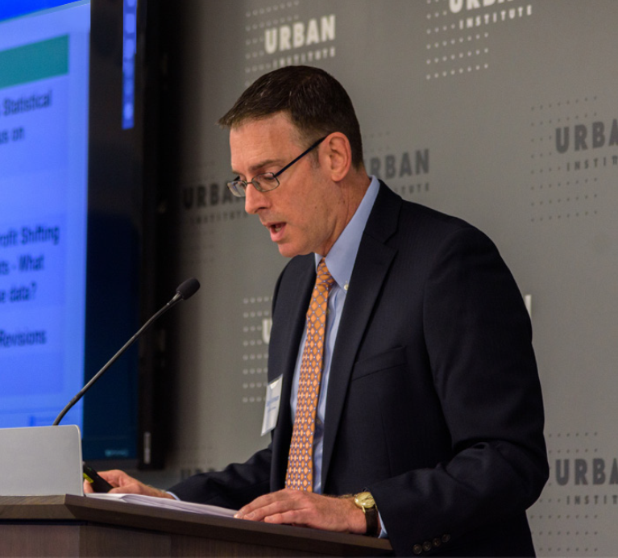
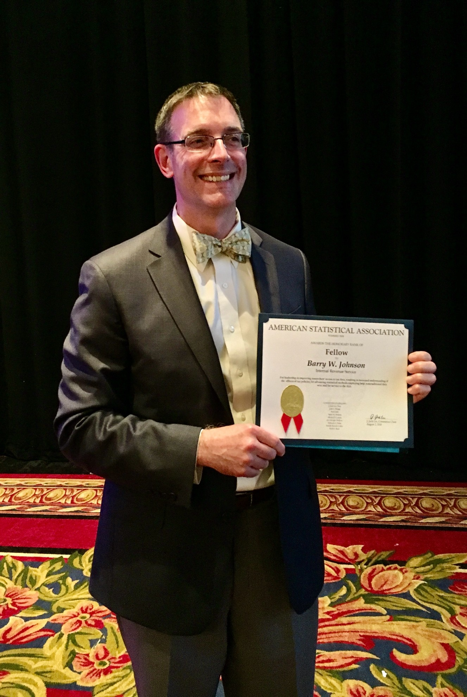
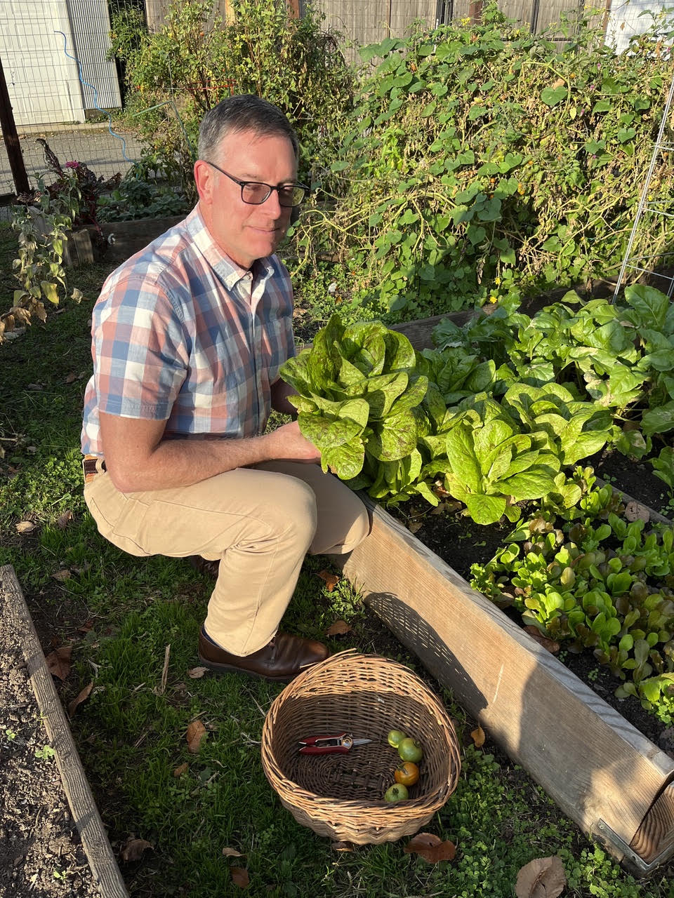

::: {.asa-service-image}
{fig-alt="Barry Johnson."}
:::

**I am honored to have been invited by the ASA Committee on Nominations run for ASA President-Elect in the April 2027 elections.**

::: {.me-section}

::: {.me-content}

# My Leadership for the Future of Statistics

**Barry Johnson | Candidate for ASA President-Elect**

I am [nonresident fellow at the Urban-Brooking Tax Policy Center](https://taxpolicycenter.org/author/barry-johnson), where my research focuses on expanding access to data for evidence building, modernizing federal statistics, protecting data confidentiality, and improving tax administration.

With 37 years of experience at the Internal Revenue Service – as the Statistics of Income Director for more than a decade, the IRS Chief Data and Analytics Officer, and responsible official for artificial intelligence – I have a longstanding commitment to the statistical community where I worked to improve federal statistics, introduce new ways to access data, and advance responsible use of artificial intelligence.

[Explore My Vision](#vision){.btn .btn-primary}
[Leadership & Experience](#leadership){.btn .btn-outline-primary}

:::

{.me-photo fig-alt="Barry Johnson, candidate for ASA President-Elect"}

:::

# My Vision for ASA {#vision}

I believe ASA should be a leader in advancing **the responsible use** of AI, modernizing the federal statistical system, and expanding safe access to official statistics.

::: {.vision-grid}

::: {.vision-card}

### Responsible AI

Advance statistical practices for assessing and addressing performance flaws in AI applications and advocate for AI governance standards to ensure these powerful new technologies perform as intended.

:::

::: {.vision-card}

### Modernizing Official Statistics

Continue statistical leadership in providing independent monitoring of the federal statistical system and advancing vision and recommendations for modernizing the system to improve timeliness, relevance, trust and privacy protection of official statistical information.

:::

:::

# My Leadership and Impact on Modernizing Federal Statistics {#leadership}

{.me-photo fig-alt="ICSP Logo"}

For most of my career I worked within the federal statistical community to modernize products and expand access to data, including more than a decade as a member of the U.S. Office of Management and Budget’s Interagency Committee on Statistical Policy (ICSP). Some of that work included:

::: {.achievement-grid}

::: {.achievement-card}

### 37 Years at the IRS

Led 5 divisions with nearly 400 statisticians, data scientists, economists, computer scientists and administrative support personnel and a $120 million budget to advance research and innovation, including AI, to improve tax administration and statistical products.

:::

::: {.achievement-card}

### Statistical System Modernization & Data Access 

Provided leadership to the ICSP for developing the [Standard Application Process](https://ncses.nsf.gov/initiatives/standard-application-process), expanding the [Federal Statistical Research Data System](https://www.census.gov/about/adrm/fsrdc.html), and initiating up the [National Secure Data Service Demonstration](https://ncses.nsf.gov/initiatives/national-secure-data-service-demo).

:::

::: {.achievement-card}

### Statistical Expertise  

Led the Statistics of Income Division of IRS in collection and dissemination of official statistics on the U.S. tax system. As the Treasury Department’s Statistical Official, I also advised on statistical activities was well as Data and AI governance for the Department.

:::

:::

# My Service to ASA and the Profession {#asa-service}

::: {.asa-service-section}

::: {.asa-service-content}

Since attending my first Joint Statistical Meetings in 1988, I have been an active participant in ASA and the broader statistical community – serving as session organizer, chair, presenter, and discussant; attending and leading committee meetings; and organizing social events. I am an ASA Fellow, an elected member of the National Bureau Economic Research’s Conference on Research on Income and Wealth, and recipient of ASA’s Roger Herriot Award for Innovation in Federal Statistics and the National Tax Association’s Bruce Davie – Albert Davis Public Service Award.

- **Federal statistics policy and advocacy:** Currently supporting ASA's [Modernizing the Federal Statistical System project](https://www.amstat.org/policy-and-advocacy/modernizing-the-federal-statistical-system/) and am a member of ASA's [Scientific Advisory Board](https://docs.google.com/document/d/1Izcm6BbyQ-SBrp0V_c2-No6-CvqUyEzve-IPgeLLj4Y/edit?tab=t.0#heading=h.dq1s60p6el7y) for the [Assessing and Monitoring the Health of Federal Statistical Agencies project](https://www.amstat.org/policy-and-advocacy/assessing-the-health-of-the-principal-federal-statistical-agencies).
- **ASA Link Lecture Award Committee:** Served 2018-2023, chair from 2020-2023
- **ASA Committee on Gay and Lesbian Concerns in Statistics:** Served for 12 years, chair from 2005–2010.
- **Other Professional leadership:** Served on the boards of the National Tax Association and the Conference on Research on Income and Wealth, and on the federal [Advisory Committee on Data for Evidence Building](https://www.bea.gov/evidence).

:::

::: {.asa-service-image}

{fig-alt="Barry Johnson, ASA Fellow picture"}

:::

:::

# My Select Writings and Work

The following are some of my recent research and writings that address data access, statistical modernization, data quality, confidentiality, and the responsible use of AI. Check out my CV for the full list of publications and other related work.

[Full CV (PDF)](images/barry-johnson-resume.pdf){.btn .btn-outline-primary}

- [Using Tax Records To Verify Residence Could Put 2030 Census Accuracy At Risk](https://taxpolicycenter.org/taxvox/using-tax-records-verify-residence-could-put-2030-census-accuracy-risk), October 5, 2026
- [Using Artificial Intelligence to Improve Official Statistics](https://apdu.org/2026/07/using-artificial-intelligence-to-improve-official-statistics/) with Aaron Williams, July 27, 2026
- [AI Threats to Official Statistics](https://apdu.org/2026/07/ai-threats-to-official-statistics/), with Aaron Williams, July 20, 2026
- [Commerce’s Data Privacy Directive Could Weaken Tax Policy Analysis](https://taxpolicycenter.org/taxvox/commerces-data-privacy-directive-could-weaken-tax-policy-analysis), with Claire McKay Bowen, June 20, 2026
- [New Data Sources to Improve Federal Statistics](https://apdu.org/2026/01/new-data-sources-to-improve-federal-statistics/), January 7, 2026

# My “What Does Barry Johnson Like to Do When Not Working in Statistics?” Section

::: {.asa-service-image}
{fig-alt="Barry Johnson gardening."}
:::

In my spare time, I’m an avid gardener, both for myself and as a volunteer at George Washington’s Mount Vernon, where I help out in the production greenhouses and historic gardens. I also enjoy working on my Victorian house in DC and am active in my church where I’ve been singing in the choir for 40 years and was recently elected to its governing body.